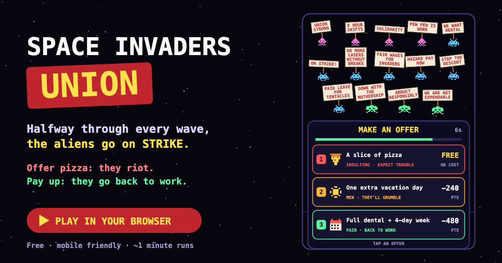

# Space Invaders Union

[](https://luisca32.github.io/space-invaders-union/)

**[▶ Play it in your browser](https://luisca32.github.io/space-invaders-union/)**. It's free, works on phones and desktops, and a run takes about a minute.

Classic Space Invaders, except the aliens have organized. Partway through every wave they go
on strike: they stop shooting, form a picket line, and hold up tiny protest signs ("FAIR WAGES
FOR INVADERS", "WE WANT DENTAL", "NO MORE LASERS WITHOUT BREAKS"). Then you have to make them
an offer.

| Offer | Example | Cost | What happens for the rest of the wave |
|---|---|---|---|
| 1 · Insulting | A slice of pizza | Free | They turn red, move and shoot much faster, and reserve aliens fly in to join them |
| 2 · Small benefit | One extra vacation day | 25% of your score | They turn orange and shoot faster |
| 3 · Big benefit | Full dental + 4-day week | 50% of your score | Nothing changes: they go back to work happy |

You have 7 seconds to decide, and saying nothing counts as an insult. Cheap offers keep your
points but make the wave much harder; fair deals cost points but keep the peace.

In the last wave, an insult sets off a **general strike**: the formation grows to 36 aliens
that shoot two at a time. Survive it and you'll have a huge score.

Clear all three waves and HR hands you your **Labor Relations Score**, from
*A+ Beloved Overlord* down to *F Galactic Labor Criminal*.

## Controls

| | Phone / tablet | Desktop |
|---|---|---|
| Move | Drag anywhere in the bottom third of the screen | ← / → or A / D |
| Fire | Hold the **FIRE** button | Hold Space |
| Make an offer | Tap a card | 1 / 2 / 3, or click a card |
| Pause | ⏸ button (top right) | P or Esc |
| Mute | 🔈 button (top right) | M |

You can't shoot while the aliens are on strike. The game pauses on its own when you switch tabs
or apps.

## How it plays

- 3 waves (Morning Shift, Overtime, Graveyard Shift), each bigger and faster than the last.
- The strike starts at a random point once 40–60% of the wave's aliens are left. The offers
  change every wave.
- You have 3 lives. You lose if the aliens shoot you 3 times or reach the ground.
- Labor Relations Score starts at 55: insulting offers −20, small benefits +5, big benefits +15,
  kept between 0 and 100. Your best score is saved in your browser.

## Run it locally

The whole game is a single `index.html` with no dependencies or build step. The graphics are
drawn in code on a `<canvas>`, and the sounds come from the Web Audio API.

```bash
git clone https://github.com/LuisCa32/space-invaders-union.git
cd space-invaders-union
python3 -m http.server 8000
```

Then open <http://localhost:8000>. You can also open `index.html` directly in a browser.
